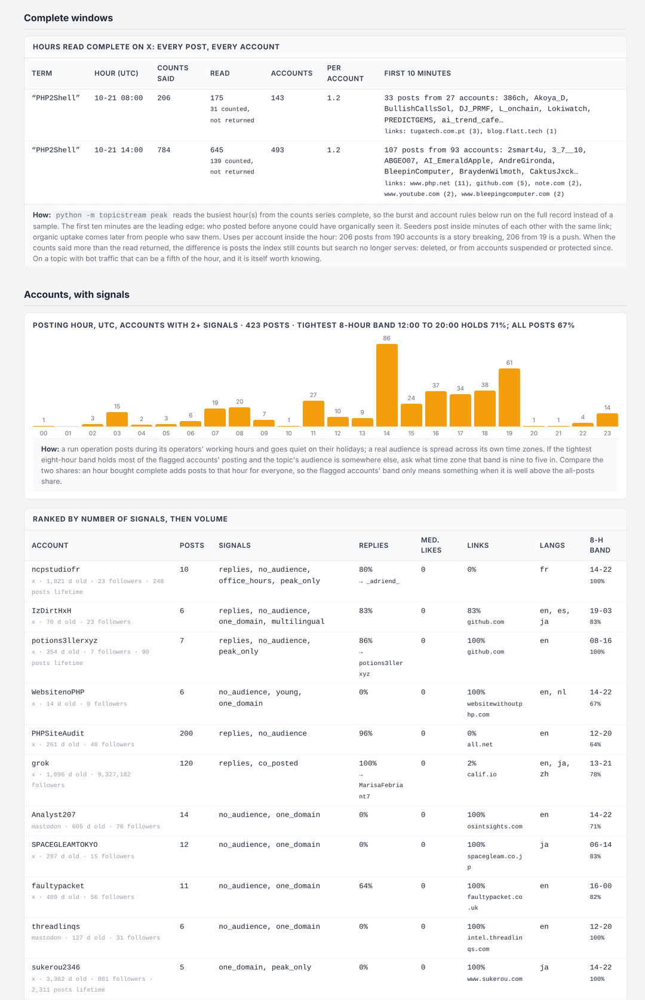

# topicstream

The honest version of a social listening dashboard. Track hashtags and phrases across Mastodon, Bluesky and X, keep every post in SQLite, and render a report with the numbers that matter when you are deciding whether an online conversation is organic or manufactured: uses and originating accounts per day, velocity alerts, uses per account, co-occurring tags, linked domains, same-text, same-link and same-message bursts, account signals, shared tracking parameters, and the tags you did not know to track yet. Every panel in the report carries a note saying exactly how its number was produced and what the platform leaves out.

On X it spends the way an analyst would: count everything (half a cent a term), read nothing until the counts say which hour matters, then buy that hour complete, so the coordination rules run on the whole record instead of a sample.

Standard library only. Nothing to install. Python 3.9 or newer. About 1,300 lines; read all of it.




## Quick start

```
git clone https://github.com/ArgeliusLabs/TopicStream.git
cd TopicStream
cp config.example.json config.json       # edit tags, servers, thresholds
python -m topicstream run                # collect, then write topicstream_report.html
```

That works with no credentials at all: Mastodon's tag timelines and tag history are public. For the other two sources, copy `.env.example` to `.env` next to your config:

```
X_BEARER_TOKEN=...        # the app's Bearer Token from the X developer console; pay-per-use, see below
BSKY_HANDLE=...           # a Bluesky account and an app password (Settings, Privacy and security, App passwords); free
BSKY_APP_PASSWORD=...
```

Commands:

```
python -m topicstream estimate      # what a run would cost on X, with live seven-day volumes for every tag and phrase (half a cent each)
python -m topicstream collect       # pull new posts and platform counts into the database
python -m topicstream report        # write the HTML report from what is stored
python -m topicstream run           # both
python -m topicstream watch --every 15     # collect and report on a loop; alerts print once, when a rule first trips
python -m topicstream peak --hours 2       # buy the busiest hours COMPLETE on X (every post, every account); --dry-run prices it first
python -m topicstream discover [--add N]   # tags riding along with what you track; --add appends the top N to the config
python -m topicstream usage         # what X's own meter says the project has consumed this billing cycle
python -m topicstream import-csv posts.csv --source mine   # analyze a posts export you already have (columns below)
```

Every command takes `--config path.json`. There are four worked configs in `examples/`.

## What each number is, and where it comes from

Strip the branding off any social listening product and there are four numbers on it. This is where each one comes from on the three platforms, and the gaps are the point.

| Number | Mastodon | Bluesky | X |
|---|---|---|---|
| Uses and originating accounts per day | `GET /api/v1/tags/{name}`: seven days of `uses` and `accounts`, free, no login. Per server: each only knows what federated to it, so poll several and never add the rows. | Nothing. Derived from the posts fetched. | `GET /2/tweets/counts/recent` (or `counts/all`): uses per minute, hour or day. No account count. |
| The posts (timestamps, authors, tags, links, engagement) | `GET /api/v1/timelines/tag/{name}`, 40 a page, free on most servers; some require a token and answer 401 or 422 (the run log says which). | `app.bsky.feed.searchPosts` with a session; the public AppView refuses it unauthenticated. Returns originals only, so a repost never counts as a use. | `GET /2/tweets/search/recent` (seven days) or `search/all` (back to 2006), $0.005 per post returned. |
| Velocity alert | computed | computed | computed from the complete counts series, not from the posts you paid for |
| Related hashtags | co-occurrence: share and lift. No platform has an endpoint for this; every tool derives it the same way. | same | same |
| Bursts | the co-posting rules: same text, same link (tracking parameters included), or same message in different words, from N distinct accounts inside a window | same | same |
| Account signals | account age, followers and lifetime post count come with each post (`account` on Mastodon, `author` on Bluesky, `expansions=author_id` on X, free); reply status and posting hours are derived | same | same |

Phrases (`terms`) are searched as a quoted phrase on X and as text on Bluesky. Mastodon has no public phrase search, so there a phrase is only matched inside posts that arrived through a tracked hashtag.

## What X costs

Pay-per-use since February 2026, no subscription: $0.005 per post returned by search, $0.005 per `counts/recent` request, $0.010 per `counts/all` request, 3 million reads a month before Enterprise. New developers get $20 in credit after saving a card and making a first purchase. Full-archive search is available on pay-per-use.

Counting is nearly free and reading is where the money goes. A seven-day, hour-by-hour volume series for a term is one request, half a cent, and it counts every post whether or not you ever read one. Reading 200 posts is a dollar; a term doing 40,000 posts a day is $200 a day if you read all of it. The tool is built around that:

1. `estimate` buys one counts request per term and prints what reading everything would cost against what your cap will read. Run it first.
2. Every collection buys the day and hour series first (a cent per term), then reads up to `max_posts_per_tag` posts.
3. After the first run, reads use `since_id`, so `watch` only pays for posts newer than the last one stored.
4. `budget_usd` caps the total recorded across every run in the database, not per run. A run that could cross it skips X and says so.
5. `query_extra` is appended to every X query; `-is:retweet` roughly halves a busy term.
6. `archive: true` with `days` above 7 uses `search/all` and `counts/all`.
7. `sample_per_day` with `sample_windows_per_day` takes a stratified sample: each UTC day split into six four-hour windows, the newest posts from each. A newest-first read of 1,000 posts covers the last day or two; a sample covers the whole event. Timing analysis on a sample is approximate, and the report says so; the counts series is the complete record.
8. `peak` reads the busiest hour(s) of the counts series in full. `--dry-run` prints the plan and the price; `--at 2026-10-21T14:00` picks an hour by hand; `--tag` limits it to one term. Hours older than seven days go through the archive endpoint on their own. A window already bought is never bought twice.
9. `read_mode: "on_alert"` turns `watch` into a tripwire: it buys only the counts series (a cent a term an hour) until an hour trips a counts rule, then buys that hour complete and stops. Three terms watched around the clock cost $0.72 a day in counts; the first alerted hour costs whatever it holds, typically $1 to $5.

Measured in November 2026 and confirmed against the developer console: X's meter counts unique posts per billing cycle. Re-reading 20 posts from a fresh database left the meter unchanged; reading 20 posts of which 14 were new moved it by 14. The tool's own ledger counts every post returned, so it is an upper bound; the meter, and the invoice, are the real number. Every collection records the meter at its start, and `usage` prints both.

A three-week retrospective on a major vulnerability (one hashtag, two phrases, 22 days, full archive, complete hourly counts, a 2,865-post stratified sample) cost $14.51. Reading everything on those queries would have been $304.

| Scenario | Cost |
|---|---|
| Probe eight candidate terms for their seven-day volumes | $0.04 |
| Hourly volume series, three terms, a full week | $0.03 |
| One complete hour of a 784-post peak | $3.92 |
| The two busiest hours of a three-week event, complete, plus the day the counts say it started | about $5 |
| Deep sample, 1,000 original posts, three terms | $15.00 |
| Watch three terms around the clock in `on_alert` mode, nothing trips | $0.72 a day |
| Watch one term for 24 hours, every 30 minutes, at most 50 new posts a run | $12.00 worst case, usually $2 to $5 |
| Read everything on a term doing 40,000 posts a day | $200 a day |

In `watch` mode the counts series is refreshed every `counts_every_minutes` (60 by default) rather than every cycle; at a 15-minute cadence that is the difference between $0.24 and $0.96 per term per day in counts alone.

One rounding to know about: the API's minimum page is 10 posts, so a cap can be overshot by up to 9 posts per query. The full breakdown, with the arithmetic for a dozen scenarios, is in [docs/x-costs.md](docs/x-costs.md).

## Finding the tags you did not know about

The tool only collects what you list, because on X every query costs money. Discovery is a separate, visible step: `discover` lists every hashtag riding along with your tracked ones, ranked by how many distinct accounts carry it, with posts per account beside it. Many accounts at one or two posts each means the topic has spread. Many posts from a handful of accounts means someone is pushing it. Both are reasons to add a tag, for different investigations. `discover --add 2` appends the top two to the config; `discover.auto` lets `watch` add one per cycle on its own, capped by `discover.max_tags`.

## Reading the report

Velocity alerts are the first window that trips a rule (what a monitor would have paged on), with the busiest window beside it. The rules are in `config.alert`: absolute uses, a multiple of the average window, and uses per originating account. There is no correct setting, only a documented one. For X, a second set of alerts comes from the counts endpoint, which is complete where the posts are not.

The per-tag sections show collected posts per day with originating accounts underneath, the X hourly series, what each platform reports for that tag by day and server, the busiest window and uses per account, related tags, linked domains, and the top originating accounts with age, followers and median likes.

Then the coordination layer, which is where the work is:

- **Complete windows.** The hours bought with `peak`, each with what the counts promised, what was read, originating accounts, posts per account, and the leading edge: who posted in the first ten minutes, before anyone could have seen it trend, and what they linked. On a sample these rules are suggestive; on a complete hour they are the record.
- **Bursts, three rules.** Same text (strip links, hashtags and mentions, group, slide a window, N distinct accounts). Same link, where the exact URL with its tracking parameters is the key: a person retyping a link does not reproduce `utm_campaign=rs9`, a tool pasting one does. Same message in different words: word-pair shingles, Jaccard similarity, clustered, which catches the 2026 version of copy-paste where a language model wrote every variant and the exact-text rule sees nothing. Each burst says how many distinct wordings it holds and how many were identical.
- **Accounts, with signals.** One row per account with the facts an analyst asks for first (posts, reply share, median likes, link share and top domain, languages, tightest eight-hour posting band) and the plain rules those facts trip: `replies` (80% or more of its posts are replies), `no_audience` (median likes zero, under 100 followers), `young` (under 30 days old), `dormant_then_active` (over a year old, under 100 lifetime posts, suddenly five or more here), `office_hours` (90% of its posting inside one eight-hour band), `one_domain`, `multilingual` (three languages at 10% or more each), `peak_only` (every post inside a bought window), `co_posted` (in a burst). A posting-hour chart for the accounts with two or more signals shows what time zone their nine-to-five is in. More signals is a reason to look, not a conclusion.
- **Creation clusters.** Weeks in which the flagged accounts were created at three times or more the rate of accounts in general: a batch.
- **Cross-platform.** The same text or link landing on two platforms within thirty minutes, which an organic audience rarely does and a scheduler always does.
- **Shared infrastructure.** Tracking parameters carried by several accounts, link shorteners, and domains ranked by how many accounts link them: the pivot to WHOIS, certificates and hosting.

Then candidate tags and a sources panel with every collection run, the spend ledger and X's meter.

Two things to keep in mind. A zero on a day is zero observed by this collection, which is a statement about the collector before it is a statement about the world. And a rule firing is a lead, not a verdict: in testing, the concentration rule caught a vulnerability feed posting 20 Cobalt Strike alerts in one minute (one account, not a network), the reply rule caught a PHP audit bot answering 193 strangers, and the one-domain-many-accounts pattern caught a Bitcoin honeypot that ten unrelated people happened to find interesting.

On the exercise dataset the tool was built to accompany, the paraphrase rule merges the two spellings of the place name the campaign used (21 accounts where the exact-text rule saw 17), the infrastructure panel finds `utm_campaign=rs9` on 26 accounts without being told to look for it, and 97% of the flagged accounts' posting falls between 01:00 and 09:00 UTC, which is nine to five in UTC+8.

## Analyzing an export you already have

`import-csv` loads a CSV with columns `timestamp_utc`, `handle`, `text`, `link`, `content_type` (`post` or `repost`), `likes`, `reposts`, `replies`, `lang` and optionally `post_id` and `in_reply_to`, and runs the same analysis. This is how the tool was validated: on the exercise dataset it was built to accompany, the alert trips in the right minute and all nine coordinated pushes come out as bursts under all three rules.

## Layout

```
topicstream/sources.py   one collector per platform, each turning the platform's JSON into the same Post shape; costs and caveats in the comments
topicstream/store.py     SQLite: posts, platform tag-days, hourly counts, complete windows, alerts, cursors, runs
topicstream/analyze.py   daily series, velocity, co-occurrence, candidates, top accounts, domains, the three burst rules, account signals, creation clusters, cross-platform, infrastructure, leading edge: a few lines each
topicstream/report.py    the HTML
topicstream/__main__.py  the commands
tests/                   offline tests against recorded response shapes (python -m unittest discover tests)
examples/                worked configs: Mastodon only, a three-week X archive retrospective, a live watch, an on-alert tripwire
```

## Configuration keys you will actually touch

| Key | Default | What it does |
|---|---|---|
| `sources.x.max_posts_per_tag` | 200 | reads per query per collection |
| `sources.x.budget_usd` | 2.0 | ceiling on the ledger across every run in the database, `peak` included |
| `sources.x.read_mode` | `always` | `on_alert`: buy counts only, read an hour complete when it trips a rule |
| `sources.x.counts_every_minutes` | 60 | how often `watch` refreshes the counts series |
| `sources.x.sample_per_day`, `sample_windows_per_day` | 0, 6 | stratified sample instead of newest-first |
| `sources.x.archive` | false | `search/all` and `counts/all` for `days` beyond 7 |
| `alert.window_minutes`, `uses`, `ratio`, `uses_per_account`, `min_uses` | 30, 200, 10, 5, 10 | the velocity rules |
| `burst.window_minutes`, `minimum` | 10, 3 | the same-text and same-link rules |
| `burst.paraphrase_window_minutes`, `paraphrase_threshold` | 60, 0.35 | the paraphrase rule (a light rewrite scores about 0.4, an unrelated post on the topic about 0.1) |
| `burst.cross_platform_minutes` | 30 | the cross-platform rule |
| `accounts.min_posts`, `top` | 3, 40 | who gets a row in the accounts table |

## What it is not

It is not a firehose. Mastodon's tag timeline and Bluesky's search are samples bounded by pagination; X's search is bounded by your budget. For live, complete coverage the next collector to add is Bluesky's Jetstream (a public websocket, no credentials), then Reddit and YouTube. TikTok's Research API and Meta's Content Library are for approved researchers only. The commercial dashboards are these same calls plus licensed firehoses plus a sales team.

## License

MIT. Built by Argelius Labs as the real-world companion to a course exercise on coordinated inauthentic behavior.
