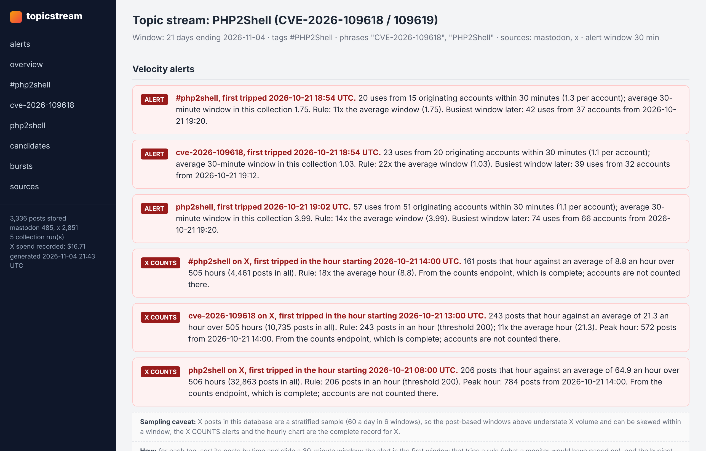
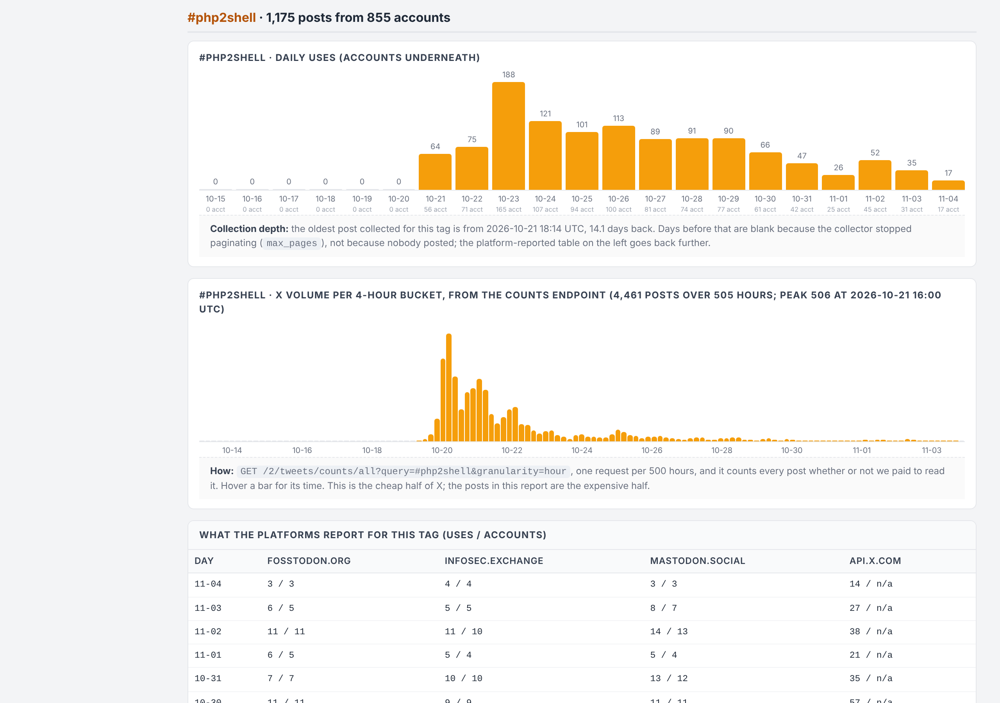

# topicstream

The honest version of a social listening dashboard. Track hashtags and phrases across Mastodon, Bluesky and X, keep every post in SQLite, and render a report with the numbers that matter when you are deciding whether an online conversation is organic or manufactured: uses and originating accounts per day, velocity alerts, uses per account, co-occurring tags, linked domains, same-text bursts, and the tags you did not know to track yet. Every panel in the report carries a note saying exactly how its number was produced and what the platform leaves out.

Standard library only. Nothing to install. Python 3.9 or newer. About 900 lines; read all of it.





## Quick start

```
git clone https://github.com/ArgeliusLabs/TopicStream.git
cd TopicStream
cp config.example.json config.json       # edit tags, servers, thresholds
python -m topicstream run                # collect, then write topicstream_report.html
```

That works with no credentials at all: Mastodon's tag timelines and tag history are public. For the other two sources, copy `.env.example` to `.env` next to your config:

```
X_BEARER_TOKEN=...        # the app's Bearer Token from the X developer console; pay-per-use, see below
BSKY_HANDLE=...           # a Bluesky account and an app password (Settings, Privacy and security, App passwords); free
BSKY_APP_PASSWORD=...
```

Commands:

```
python -m topicstream estimate      # what a run would cost on X, with live seven-day volumes for every tag and phrase (half a cent each)
python -m topicstream collect       # pull new posts and platform counts into the database
python -m topicstream report        # write the HTML report from what is stored
python -m topicstream run           # both
python -m topicstream watch --every 15     # collect and report on a loop; alerts print once, when a rule first trips
python -m topicstream discover [--add N]   # tags riding along with what you track; --add appends the top N to the config
python -m topicstream usage         # what X's own meter says the project has consumed this billing cycle
python -m topicstream import-csv posts.csv --source mine   # analyze a posts export you already have (columns below)
```

Every command takes `--config path.json`. There are three worked configs in `examples/`.

## What each number is, and where it comes from

Strip the branding off any social listening product and there are four numbers on it. This is where each one comes from on the three platforms, and the gaps are the point.

| Number | Mastodon | Bluesky | X |
|---|---|---|---|
| Uses and originating accounts per day | `GET /api/v1/tags/{name}`: seven days of `uses` and `accounts`, free, no login. Per server: each only knows what federated to it, so poll several and never add the rows. | Nothing. Derived from the posts fetched. | `GET /2/tweets/counts/recent` (or `counts/all`): uses per minute, hour or day. No account count. |
| The posts (timestamps, authors, tags, links, engagement) | `GET /api/v1/timelines/tag/{name}`, 40 a page, free on most servers; some require a token and answer 401 or 422 (the run log says which). | `app.bsky.feed.searchPosts` with a session; the public AppView refuses it unauthenticated. Returns originals only, so a repost never counts as a use. | `GET /2/tweets/search/recent` (seven days) or `search/all` (back to 2006), $0.005 per post returned. |
| Velocity alert | computed | computed | computed from the complete counts series, not from the posts you paid for |
| Related hashtags | co-occurrence: share and lift. No platform has an endpoint for this; every tool derives it the same way. | same | same |
| Same-text bursts | the co-posting rule: strip links, hashtags and mentions, group by text, slide a window, report groups with N distinct accounts | same | same |

Phrases (`terms`) are searched as a quoted phrase on X and as text on Bluesky. Mastodon has no public phrase search, so there a phrase is only matched inside posts that arrived through a tracked hashtag.

## What X costs

Pay-per-use since February 2026, no subscription: $0.005 per post returned by search, $0.005 per `counts/recent` request, $0.010 per `counts/all` request, 3 million reads a month before Enterprise. New developers get $20 in credit after saving a card and making a first purchase. Full-archive search is available on pay-per-use.

Counting is nearly free and reading is where the money goes. A seven-day, hour-by-hour volume series for a term is one request, half a cent, and it counts every post whether or not you ever read one. Reading 200 posts is a dollar; a term doing 40,000 posts a day is $200 a day if you read all of it. The tool is built around that:

1. `estimate` buys one counts request per term and prints what reading everything would cost against what your cap will read. Run it first.
2. Every collection buys the day and hour series first (a cent per term), then reads up to `max_posts_per_tag` posts.
3. After the first run, reads use `since_id`, so `watch` only pays for posts newer than the last one stored.
4. `budget_usd` caps the total recorded across every run in the database, not per run. A run that could cross it skips X and says so.
5. `query_extra` is appended to every X query; `-is:retweet` roughly halves a busy term.
6. `archive: true` with `days` above 7 uses `search/all` and `counts/all`.
7. `sample_per_day` with `sample_windows_per_day` takes a stratified sample: each UTC day split into six four-hour windows, the newest posts from each. A newest-first read of 1,000 posts covers the last day or two; a sample covers the whole event. Timing analysis on a sample is approximate, and the report says so; the counts series is the complete record.

Measured in November 2026 and confirmed against the developer console: X's meter counts unique posts per billing cycle. Re-reading 20 posts from a fresh database left the meter unchanged; reading 20 posts of which 14 were new moved it by 14. The tool's own ledger counts every post returned, so it is an upper bound; the meter, and the invoice, are the real number. Every collection records the meter at its start, and `usage` prints both.

A three-week retrospective on a major vulnerability (one hashtag, two phrases, 22 days, full archive, complete hourly counts, a 2,865-post stratified sample) cost $14.51. Reading everything on those queries would have been $304.

| Scenario | Cost |
|---|---|
| Probe eight candidate terms for their seven-day volumes | $0.04 |
| Hourly volume series, three terms, a full week | $0.03 |
| One complete hour of a 784-post peak | $3.92 |
| Deep sample, 1,000 original posts, three terms | $15.00 |
| Watch one term for 24 hours, every 30 minutes, at most 50 new posts a run | $12.00 worst case, usually $2 to $5 |
| Read everything on a term doing 40,000 posts a day | $200 a day |

In `watch` mode the counts series is refreshed every `counts_every_minutes` (60 by default) rather than every cycle; at a 15-minute cadence that is the difference between $0.24 and $0.96 per term per day in counts alone.

One rounding to know about: the API's minimum page is 10 posts, so a cap can be overshot by up to 9 posts per query. The full breakdown, with the arithmetic for a dozen scenarios, is in [docs/x-costs.md](docs/x-costs.md).

## Finding the tags you did not know about

The tool only collects what you list, because on X every query costs money. Discovery is a separate, visible step: `discover` lists every hashtag riding along with your tracked ones, ranked by how many distinct accounts carry it, with posts per account beside it. Many accounts at one or two posts each means the topic has spread. Many posts from a handful of accounts means someone is pushing it. Both are reasons to add a tag, for different investigations. `discover --add 2` appends the top two to the config; `discover.auto` lets `watch` add one per cycle on its own, capped by `discover.max_tags`.

## Reading the report

Velocity alerts are the first window that trips a rule (what a monitor would have paged on), with the busiest window beside it. The rules are in `config.alert`: absolute uses, a multiple of the average window, and uses per originating account. There is no correct setting, only a documented one. For X, a second set of alerts comes from the counts endpoint, which is complete where the posts are not.

The per-tag sections show collected posts per day with originating accounts underneath, the X hourly series, what each platform reports for that tag by day and server, the busiest window and uses per account, related tags, linked domains, and the top originating accounts with age, followers and median likes. Then candidate tags, same-text bursts, and a sources panel with every collection run, the spend ledger and X's meter.

Two things to keep in mind. A zero on a day is zero observed by this collection, which is a statement about the collector before it is a statement about the world. And a rule firing is a lead, not a verdict: in testing, the concentration rule caught a vulnerability feed posting 20 Cobalt Strike alerts in one minute (one account, not a network), and the one-domain-many-accounts pattern caught a Bitcoin honeypot that ten unrelated people happened to find interesting.

## Analyzing an export you already have

`import-csv` loads a CSV with columns `timestamp_utc`, `handle`, `text`, `link`, `content_type` (`post` or `repost`), `likes`, `reposts`, `replies`, `lang` and optionally `post_id`, and runs the same analysis. This is how the tool was validated: on the exercise dataset it was built to accompany, the alert trips in the right minute and all nine coordinated pushes come out as bursts.

## Layout

```
topicstream/sources.py   one collector per platform, each turning the platform's JSON into the same Post shape; costs and caveats in the comments
topicstream/store.py     SQLite: posts, platform tag-days, hourly counts, alerts, cursors, runs
topicstream/analyze.py   daily series, velocity, co-occurrence, candidates, top accounts, domains, bursts: a few lines each
topicstream/report.py    the HTML
topicstream/__main__.py  the commands
tests/                   offline tests against recorded response shapes (python -m unittest discover tests)
examples/                worked configs: Mastodon only, a three-week X archive retrospective, a live watch
```

## What it is not

It is not a firehose. Mastodon's tag timeline and Bluesky's search are samples bounded by pagination; X's search is bounded by your budget. For live, complete coverage the next collector to add is Bluesky's Jetstream (a public websocket, no credentials), then Reddit and YouTube. TikTok's Research API and Meta's Content Library are for approved researchers only. The commercial dashboards are these same calls plus licensed firehoses plus a sales team.

## License

MIT. Built by Argelius Labs as the real-world companion to a course exercise on coordinated inauthentic behavior.
