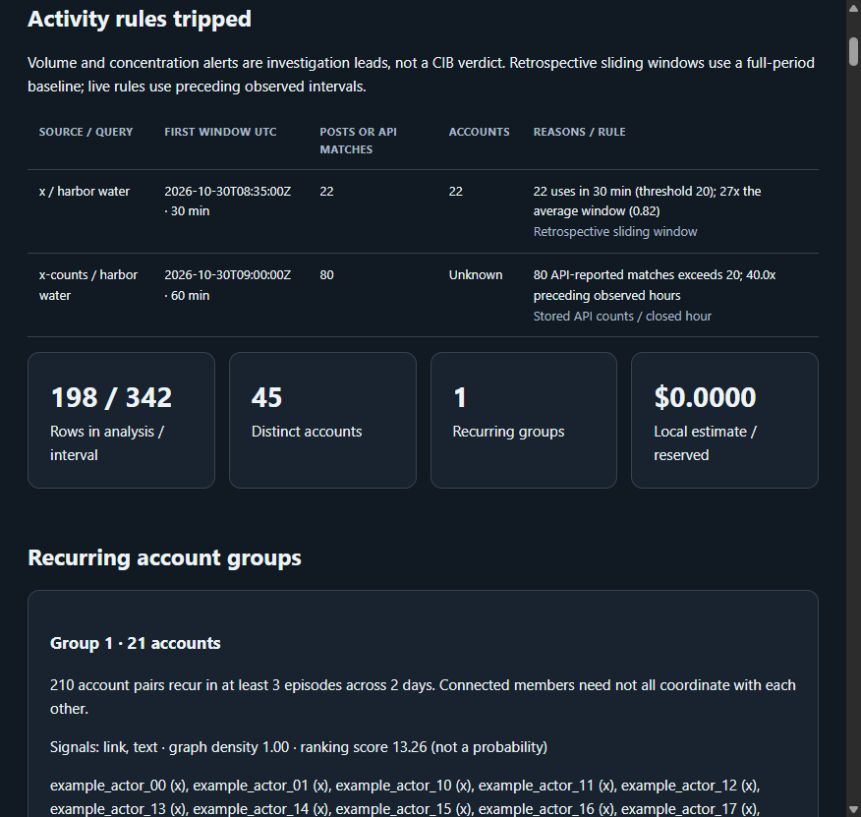
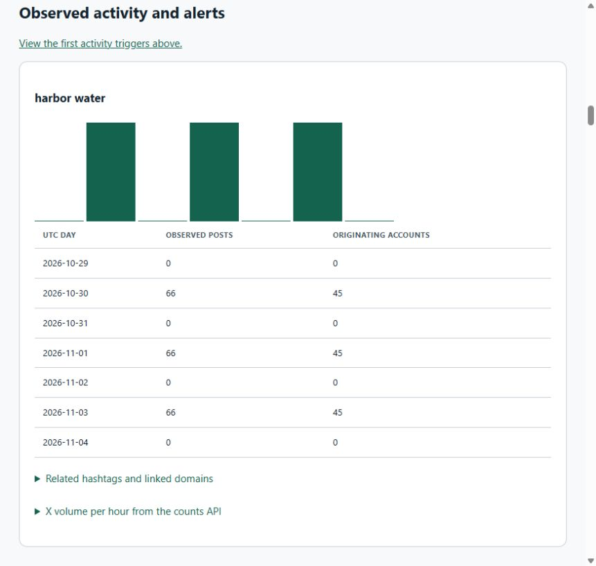
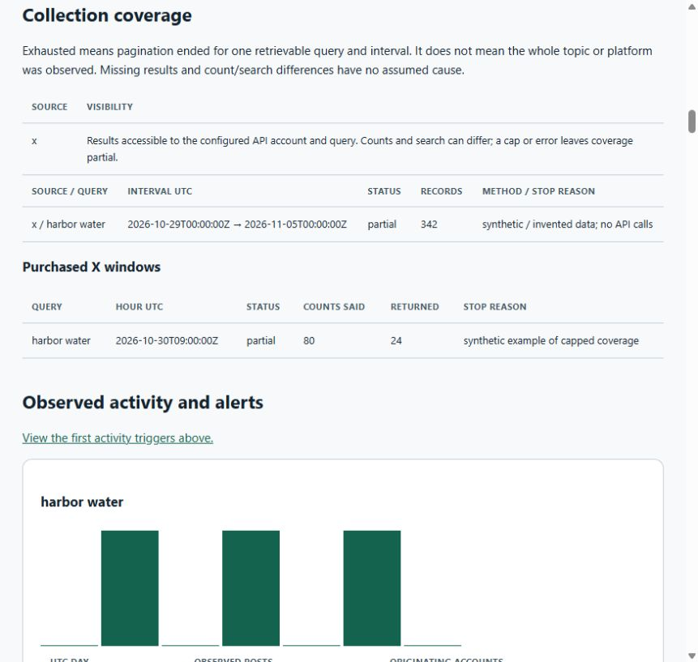

# Current report examples

These screenshots show TopicStream **0.3.2**, captured November 5, 2026. All accounts, posts, counts, and collection-window records are invented demonstration data. They are not the Singapore pilot or a classroom export, and no API requests were made to generate them.

Reproduce the example from the checkout:

```console
python examples/build_report_demo.py --data-dir ./demo-cases
python -m topicstream serve --data-dir ./demo-cases
```

Open the printed report path directly, or open the case in the local workspace and select its HTML report. The example includes 342 stored rows, 198 rows in analysis, and a 21-account group with 210 recurring pairs. It deliberately illustrates a detected group; it is not an accuracy benchmark.

## Headline triggers and scope

Activity triggers show source/query, first window, observed posts or API matches, account counts where known, and rule provenance. Pair tables are collapsed, with the first 25 ranked pairs and a separate control for the rest. Every pair remains in the file.



## Activity in the light theme

The theme toggle works offline. Daily activity remains scoped to the investigation; the separate posting-hour comparison uses all stored rows inside the bounds and the available query-specific hourly counts.



## Coverage and peak-window status

The invented capped-window example remains partial. It demonstrates how an unfinished collection is displayed; it is not a real purchase or provider response.



Evidence links expand their target event or post and its parent section. Printing expands all reference sections with a light background and black text, then restores the screen's collapsed state after printing. A large case can therefore produce many printed pages even when its on-screen report is compact.
