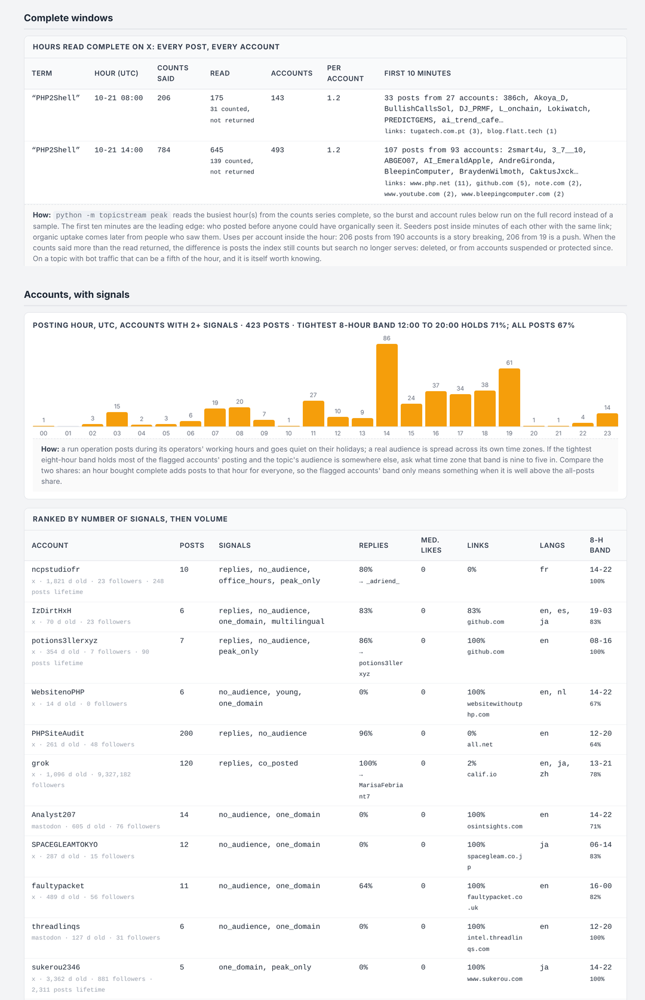
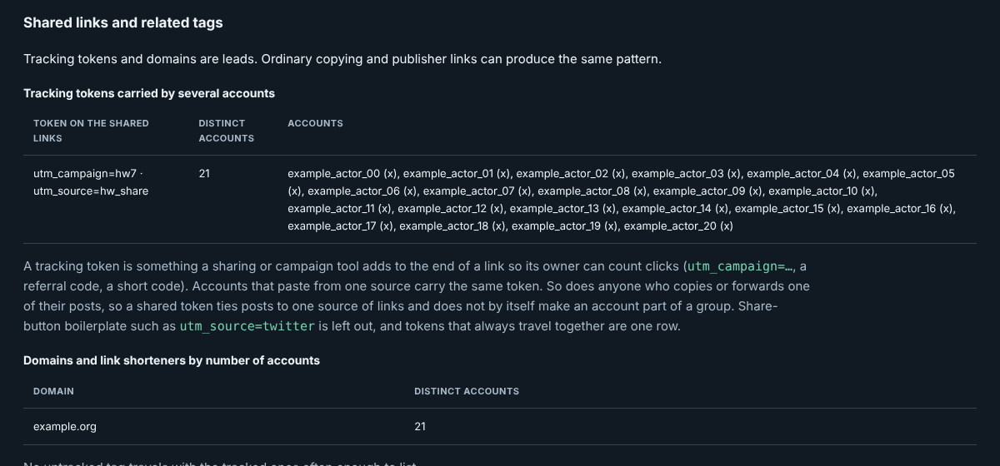

# Current report examples

The first three screenshots show TopicStream **0.3.2**, captured November 5, 2026; the last two show the panels restored in **0.3.9** and **0.3.10**, captured November 25, 2026. All accounts, posts, counts, and collection-window records are invented demonstration data. They are not the Singapore pilot or a classroom export, and no API requests were made to generate them.

Reproduce the example from the checkout:

```console
python examples/build_report_demo.py --data-dir ./demo-cases
python -m topicstream serve --data-dir ./demo-cases
```

Open the printed report path directly, or open the case in the local workspace and select its HTML report. The example includes 342 stored rows, 198 rows in analysis, and a 21-account group with 210 recurring pairs. It deliberately illustrates a detected group; it is not an accuracy benchmark.

## Headline triggers and scope

Activity triggers show source/query, first window, observed posts or API matches, account counts where known, and rule provenance. Pair tables are collapsed, with the first 25 ranked pairs and a separate control for the rest. Every pair remains in the file.


## Activity in the light theme

The theme toggle works offline. Daily activity remains scoped to the investigation; the separate posting-hour comparison uses all stored rows inside the bounds and the available query-specific hourly counts.


## Coverage and peak-window status

The invented capped-window example remains partial. It demonstrates how an unfinished collection is displayed; it is not a real purchase or provider response.



## Top originating accounts

Each tag or term card lists up to fifteen accounts that used it most, most posts first, with how many of those posts are reposts and what the platform says about each account: age at first post, followers and median likes. The Account observations table carries the same facts (Followers, Lifetime posts, Median likes) beside each account's signals. "Unknown" is shown where a profile was not collected.


## Tracking tokens and shared domains

Under Shared links and related tags, the report lists each tracking token that three or more accounts carry on their links, with the accounts. The note under the table says what a shared token does and does not show.



Evidence links expand their target event or post and its parent section. Printing expands all reference sections with a light background and black text, then restores the screen's collapsed state after printing. A large case can therefore produce many printed pages even when its on-screen report is compact.
